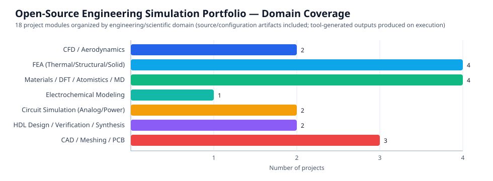

# Results Dashboard

This dashboard reports the **actual, verifiable artifacts included in this repository** and the execution status of simulation/design workflows. No numerical simulation results are fabricated.

## Portfolio status (included artifacts)

| Metric | Value |
|---|---:|
| Project modules | 18 |
| Per-project README files | 18 |
| Root documentation/license/landing page | Included (`README.md`, `LICENSE`, `index.html`) |
| CI & validation | Included (`.github/workflows/ci.yml`, `scripts/validate_portfolio.py`) |
| Leftover ZIP archives in root | 0 (extracted into project directories) |

## Per-project artifact and execution status

| Project | Domain | Key source artifacts (included) | Included tests/checks | Tool-generated outputs in repo |
|---|---|---|---|---|
| 01 OpenFOAM Lid-Driven Cavity | CFD | `0/`, `system/`, `constant/`, `Allrun`, `Allclean` | None bundled | Not included (run `icoFoam`/`blockMesh`) |
| 02 Elmer Plate Heat Conduction | Heat transfer FEA | `case.sif`, `plate.geo`, `run.sh` | None bundled | Not included (run Elmer/Gmsh) |
| 03 CadQuery Parametric Flange | CAD | `flange.py`, `tests/test_flange.py`, `requirements.txt` | `pytest` tests (need CadQuery) | Not included (export STEP/STL on run) |
| 04 FEniCSx Cantilever Elasticity | Solid mechanics FEA | `cantilever.py` | None bundled | Not included (run FEniCSx; XDMF output) |
| 05 OpenSCAD Parametric Enclosure | CAD | `enclosure.scad`, `Makefile` | None bundled | Not included (render STL on run) |
| 06 SU2 NACA 0012 Transonic | Aerodynamics CFD | `naca0012.cfg`, `make_mesh.py`, `plot_cp.py`, `run.sh` | None bundled | Not included (run SU2/Gmsh) |
| 07 Quantum ESPRESSO Silicon | DFT | `scf.in.template`, `bands.in`, `bandsx.in`, `convergence.py`, `plot_bands.py`, `run.sh`, `pseudo/README.txt` | None bundled | Not included (requires QE + pseudopotential) |
| 08 pymatgen Crystal Analysis | Materials informatics | `analyze.py`, `test_analyze.py`, `requirements.txt` | `pytest` tests (need pymatgen) | Not included (generated on run) |
| 09 PyBaMM Battery Simulation | Electrochemistry | `simulate.py`, `requirements.txt` | None bundled | Not included (plots/data on run) |
| 10 ngspice Analog Filters | Analog circuits | `rc_diode_clipper.cir`, `rlc_lowpass.cir`, `plot.py`, `run.sh` | None bundled | Not included (run ngspice) |
| 11 Xyce Bridge Rectifier | Power electronics | `bridge.cir`, `analyze.py`, `run.sh` | None bundled | Not included (run Xyce) |
| 12 ASE Surface Adsorption | Atomistic modeling | `workflow.py`, `requirements.txt` | None bundled | Not included (run ASE workflow) |
| 13 CalculiX Cantilever Beam | Structural FEA | `make_inp.py`, `check.py`, `run.sh` | Check script (needs solver outputs) | Not included (run ccx/Gmsh) |
| 14 LAMMPS Argon Liquid | Molecular dynamics | `in.argon`, `analyze.py`, `run.sh` | None bundled | Not included (run LAMMPS) |
| 15 Yosys ALU Synthesis | Digital HDL | `alu.v`, `tb.v`, `synth.ys`, `run.sh` | Self-checking testbench (needs iverilog/yosys) | Not included (sim/synth outputs on run) |
| 16 Gmsh Adaptive Plate with Hole | Meshing | `mesh_plate.py`, `requirements.txt` | None bundled | Not included (mesh generated on run) |
| 17 Verilator Sync FIFO | HDL verification | `fifo.v`, `tb.cpp`, `Makefile` | C++ testbench (needs Verilator) | Not included (sim binary/output on run) |
| 18 KiCad 555 Astable Blinker | PCB/electronics | `design_calc.py`, `netlist.py`, `bom.csv`, `docs/layout_checklist.md`, `Makefile` | Design utilities | Not included (EDA exports depend on KiCad/run) |

## Interpretation notes

- “Not included” means solver/EDA/CAD-generated outputs are **expected products of execution**, not missing claimed evidence. Run the documented workflows in properly configured environments to generate them.
- Python syntax/structure validation and portfolio integrity checks are automated in CI; domain-tool execution requires the respective external toolchains.
- For exact per-project inputs, commands, and assumptions, see each project's `README.md`.
